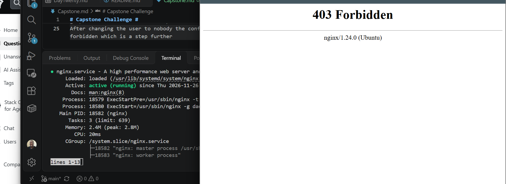
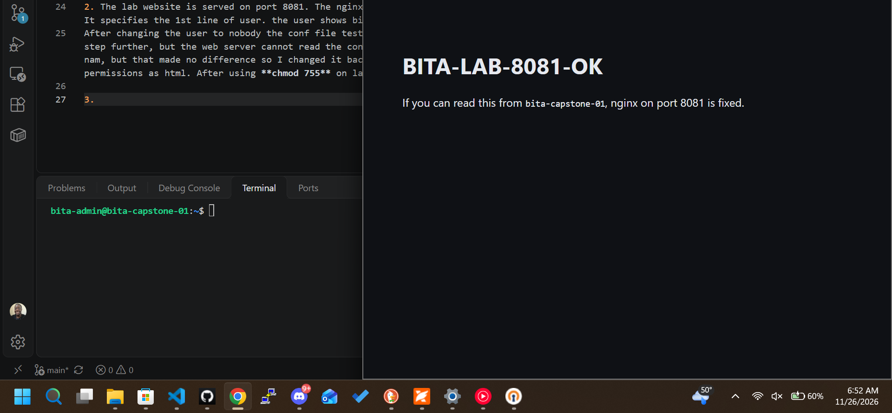
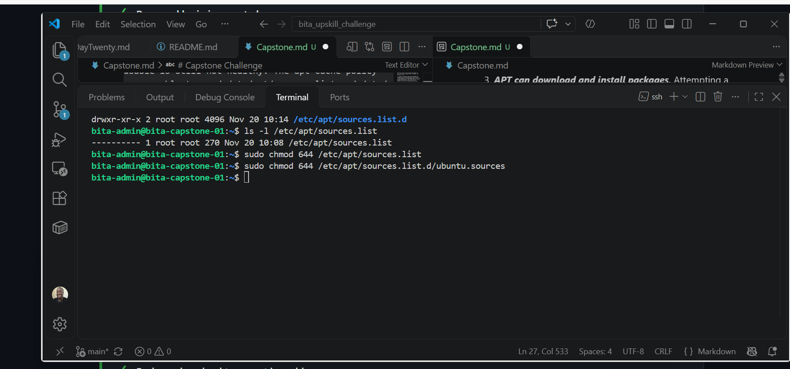
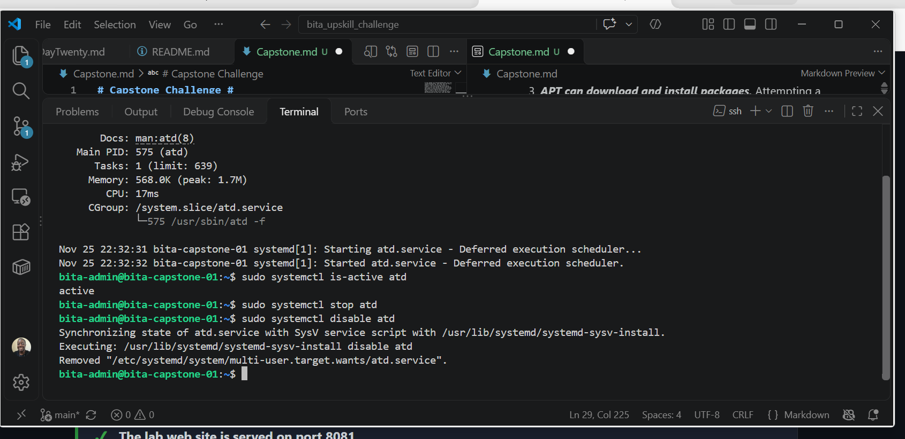
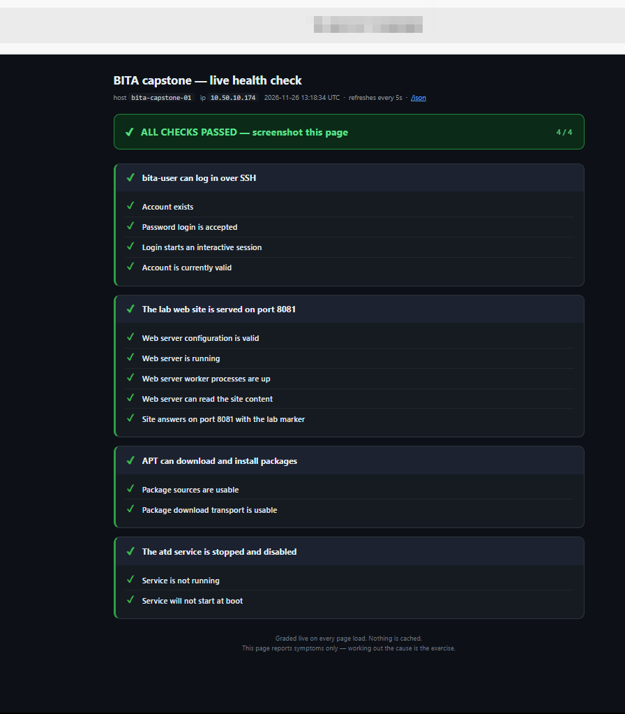

# Capstone Challenge #

We are the finish line!

What is left to do but the capstone. See what you have learned and put it all together.

The first step is to install and run OpenVpn. Then install the bita-capstone.opvn an connect. 

<!-- insert the open screenshot-->

Step 2 - Validating The Tunnel: while connected to the vpn the next step is to validate the tunnel which shows a 10.8.0.0/24 address which it does. And then ping my lab box which is successful 

<!-- insert photo of successful ping-->

Step 3 - Your Lab Box: This step is logging in the bita-admin account. There are four checks that are failing. My job is to fix the broken checks:

* bita-user can log in over SSH
* The lab website is served on port 8081
* APT can download and install packages
* The atd service is stopped and disabled

1. ***Bita-user can login over SSH.*** I found that the bita-user account is locked and shell is set to nologin. after changing the shell and unlocking the account, bita-user is able to login.

2. ***The lab website is served on port 8081.*** The nginx service has failed the active status. Result exit-code. getpwnam failed conf file. It specifies the 1st line of user. the user shows bita-broken and there's no such user.
After changing the user to nobody the conf file test is successful. I restarted the nginx service and it's showing forbidden which is a step further, but the web server cannot read the content. At first I thought it was because the html index file had nginx.debian in the nam, but that made no difference so I changed it back just in case. The issue though the **lab8081** directory doesn't have the same permissions as html. After using **chmod 755** on lab8081, the content is live.

3. ***APT can download and install packages.*** Attempting a sudo apt update gets errors *Failed to exec method /usr/lib/apt/methods/http (via /usr/lib/apt/methods/http). That means that the http is unable to execute. The apt is now able to transport. The issue of package sources being usable is still not healthy. The apt cache policy says unable to read /etc/apt/sources.list and /etc/apt/sources.list.d/ubuntu.sources. A look at both files' ls shows it has no file permissions. I checked in my own server to do a side by side of what permissions my server has. After 644 chmod the package sources are now usable. Another healthy status.

4. ***The atd service is stopped and disabled.*** The atd sevice is the background service used to manages one time service jobs. For example **at restart, do task*** not like cron which schedules jobs for repetitive tasks. Doing a systemctl stop and disable on atd does it's name respectfully. And that is the last of the checks! Our capstone is done!!!

