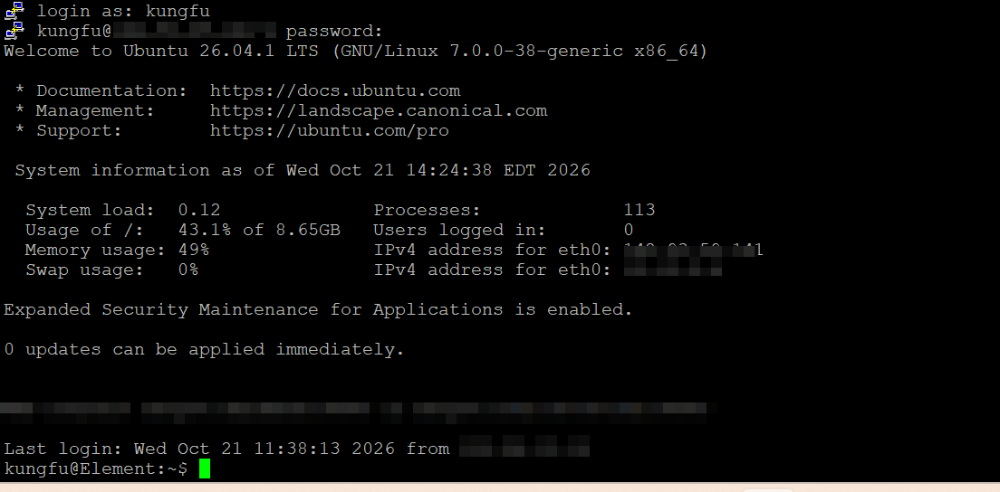

# DayOne: Getting To Know My Server #

## It is 9/15 and I have successully logged in the server through powershell. ##
I kept getting an access denied public key error and didn't understand why. I destroyed and recreated the droplet. I just didn't understand what the username was. But I got it. And I got in. Restarted the server with the ssh client as needed. Updated the Ubuntu server. Checked general information about king.kunta.
My server has a name and a sudo user.

I am retroactively adding a photo to show that I am in the server

